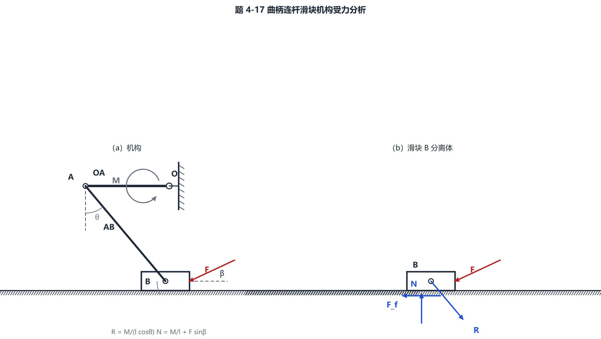

# mechanics-tutor

> 给 **DeepSeek Harness**（也可当作通用 agent 提示词）用的力学解题技能：
> 课本照片 → 几何转录核对 → sympy 符号解 + 残差验算 → 受力图（自带排版 lint）→ 力偶转向自检。

面向中文教材体系：理论力学 / 静力学 / 材料力学。题型对照按哈工大《理论力学》(I) 第八版章序整理。



## 它解决什么问题

学生拍一张课本照片发过来，普通做法是：看一眼 → 直接算 → 画一张歪图。错的地方通常是三处：
**读错几何、算完不验、图画不明白**。

这个技能把这三处变成必须过的闸：

1. **几何转录单** —— 从照片读到的每一个量先逐条列给用户核；角度标注有歧义时，用几何可行性排除后写明理由，不许猜。
2. **符号解 + 验算** —— 先用 sympy 出符号解，再代数值；`verify()` 打出 `[OK] 全部方程代回通过` 才算过，
   任何一式代完还残留符号直接判 FAIL（假通过比算错更危险）。
3. **受力图 + 排版 lint** —— `fbd.py` 生成 SVG 再转 PNG，内置检查：
   文字互压、元素出画布是**硬冲突**（0 处才能交图），文字压在线上只算提示（教科书标签本来就压线）。
4. **力偶转向自检** —— 题图有力偶时，另出一张小图并排画顺/逆时针，核对箭头方向。
   画反的力偶比排版丑严重得多：学生照着抄就错。

## 仓库内容

| 文件 | 作用 |
|---|---|
| `skill/SKILL.md` | 完整流程、四道闸、常见错误表、交卷自检清单 |
| `skill/fbd.py` | 声明式受力图：构件 / 铰 / 套筒 / 绳 / 支座 / 分布载荷 / 尺寸 / 角度 / 力偶；纯标准库，SVG→PNG 用本机 Edge |
| `skill/mechkit.py` | 二维力矩 `mz()`、符号求解 `solve()`、代回验算 `verify()`、极限检查（依赖 sympy） |
| `skill/templates.py` | 9 个画图骨架：简支梁、悬臂梁、斜面滑块、梯子、两索汇交、套筒滑块、升降箱卡滞、三角桁架、曲柄连杆滑块 |
| `skill/TYPES.md` | 23 类题型的识别特征 / 标准步骤 / 易错点 |

示例输出在 `examples/`：机构题、安全钳、尖劈、缠绳的轮。

## 安装

```bash
git clone https://github.com/scp-666-hub/mechanics-tutor.git ~/.dsh/skills/mechanics-tutor
pip install sympy
```

然后按你的实际路径，把 `SKILL.md` 里 `sys.path.insert(...)` 与解释器那几行改成本机的
（本仓库不写死任何用户目录）。出图需要本机装有 Microsoft Edge（headless 截图用），
`fbd.find_edge()` 会自动找常见安装位置。

## 用法

把题图发给 agent，说「做一下 4-24」即可。它会：

1. 转正 / 裁切题图，读几何 → 给你一张转录单；
2. 用 sympy 解，跑残差与极限检查；
3. 出受力图，lint 到 0 硬冲突；
4. 按「已知 / 解 / 答 / 易错点」输出，公式用 LaTeX 渲染，不用代码块。

## 实测效果

同一位用户二十余道课本习题：

- 单题工具往返从 **30 次降到 10 次左右**；
- 耗时从 **15 分钟降到 2–6 分钟**（简单题快一半以上，几何含糊的难题约三成）；
- 提升主要来自三件事：几何先核对（少推翻重来）、求解与出图合并成一个脚本、
  出图 lint 把「一版一版调到满意」变成「0 硬冲突就交图」。

这不是基准测试，是同一台机器、同一个模型、前后对比的实测。

## 踩过的坑（都写进 SKILL.md 了）

- **力臂少一个 cosθ**：`M = C·l·cosθ` 写成 `M = C·l`，答案差一个因子。
- **摩擦只算一向**：静摩擦平衡题要两个方向各算一次，只算一向就漏掉一半答案。
- **力偶箭头画反**：所以有了第四道闸。
- **为一个标签重叠反复重画**：一题能烧掉四五轮。所以把 lint 分成硬冲突 / 软提示。
- **「检查全绿」≠ 能用**：图必须自己看一眼，lint 只量文字框，量不了「看起来对不对」。

## 可选：更完整的图与视觉自检

剪力 / 弯矩 / 轴力 / 扭矩图、应力分布、莫尔圆、挠曲线、题图批量预处理（转正、去斜、一页多题分栏）、
独立视觉模型评图 —— 这些来自开源插件 [dsh-mech-workbench](https://github.com/insideyou-0501/dsh-mech-workbench)（MIT）。
**本仓库不包含它的代码**，需要时自行安装或只借用它的 `scripts/`。

## License

MIT
